<div align="center">

<picture>
  <source media="(prefers-color-scheme: dark)" srcset=".github/assets/banner-dark.svg">
  
</picture>

**The official toolchain for building PAM Native plugins.**<br>
Validate plugin manifests, compile one typed IDL into PHP, Kotlin and Swift, scaffold cross-platform packages with CI, and certify them with a portable conformance report.

[](https://packagist.org/packages/pushinbr/pam-native-plugin-kit)
[](https://github.com/push-in/pam-native-plugin-kit/releases/latest)

[](https://github.com/push-in/pam-native-plugin-kit/actions/workflows/ci.yml)
[](LICENSE)

[Install](#install) · [Quick example](#quick-example) · [Typed IDL](#typed-idl) · [Conformance](#portable-contributor-certification) · [Docs](#docs) · [Issues](https://github.com/push-in/pam-native-plugin-kit/issues)

</div>

<a id="install"></a>
## <picture></picture> Install

Inside a PAM project, as a development tool:

```sh
pam composer require --dev pushinbr/pam-native-plugin-kit
```

The kit is plain PHP with no runtime dependency. Its CLI is `vendor/bin/pam-native-plugin`; run it on PAM's PHP runtime with `pam exec` as shown below. New to PAM? `pam init my-app --template native` creates a PAM Native project (see the [PAM Native overview](https://push-in.github.io/pam-docs/native/overview/)).

<a id="quick-example"></a>
## <picture></picture> Quick example

```sh
pam exec vendor/bin/pam-native-plugin new acme/pam-native-biometric ./pam-native-biometric
pam exec vendor/bin/pam-native-plugin validate ./pam-native-biometric/pam-native.plugin.json
pam exec vendor/bin/pam-native-plugin compile ./pam-native-biometric/pam-native.idl.json ./generated
pam exec vendor/bin/pam-native-plugin conformance ./pam-native-biometric --json > conformance.json
```

`new` writes a cross-platform package (`pam-native.plugin.json`, `pam-native.idl.json`, `src/`, `android/`, `ios/`, `tests/`, CI). `compile` writes `Contracts.php`, `Contracts.kt` and `Contracts.swift`. Every command exits non-zero on failure.

<a id="platform-support"></a>
## <picture></picture> Platform support

| Platform | Support | Notes |
| --- | --- | --- |
| PHP | 8.5+ | No other runtime dependency (`composer.json`) |
| Generated code | PHP · Kotlin · Swift | From one `pam-native.idl.json` |
| Scaffolded plugins | Android · iOS | Native SDK builds, device tests and signing stay in the plugin's own CI |

<a id="typed-idl"></a>
## <picture></picture> Typed IDL

Coded variants are integer enums with sequential values beginning at `1`. The compiler rejects gaps and string variants so PHP, Kotlin and Swift cannot silently disagree about wire values.

```json
{
    "version": 1,
    "namespace": "Acme.Biometric",
    "enums": {
        "AuthenticationState": {
            "Pending": 1,
            "Authenticated": 2,
            "Rejected": 3
        }
    },
    "records": {
        "AuthenticationResult": {
            "state": "AuthenticationState",
            "reason": "string?"
        }
    }
}
```

Generated sources are deterministic and suitable for committing or checking in CI. The plugin manifest and IDL digests are recorded by PAM Native in `.pam-native/plugins.lock.json`. The schema is `resources/pam-native.idl.schema.json`.

<a id="portable-contributor-certification"></a>
## <picture></picture> Portable contributor certification

`conformance` is a non-mutating, dependency-free package audit that can run before native SDK jobs. It emits schema `1`, Native `surfaceCode: 2`, sequential integer result/check codes, and SHA-256 evidence for seven bounded checks:

1. manifest validation;
2. typed IDL compilation;
3. byte-for-byte PHP/Kotlin/Swift generation determinism;
4. Composer plugin metadata;
5. declared Kotlin source evidence;
6. declared Swift source evidence;
7. the portable PHP test entrypoint.

The runner reads at most 1 MiB per document, 256 native source files and 16 MiB per platform. Package paths are confined segment-by-segment; symlinks, traversal, duplicate source evidence and empty native source sets fail closed. The JSON contract is `resources/pam-native-conformance.schema.json`. This portable report does not replace Android/iOS compilation, device tests, signing or store validation.

<a id="api-guide"></a>
## <picture></picture> API guide

| API | Responsibility |
| --- | --- |
| `Scaffolder` | Create a cross-platform plugin repository with CI. |
| `ManifestValidator` | Validate plugin metadata, native sources, and declared contracts. |
| `IdlCompiler` | Generate deterministic PHP, Kotlin, and Swift types from one IDL. |
| `ConformanceRunner` / `ConformanceReport` | Run the seven portable checks and export the report. |
| `Diagnostic` / `ValidationResult` | Consume typed validation findings in tooling or CI. |

All coded states, kinds, and variants are sequential integer-backed enums. Use enum cases in application code; do not depend on raw wire numbers.

<a id="production-checklist"></a>
## <picture></picture> Production checklist

- Commit generated sources and verify regeneration is clean in CI.
- Use sequential integer enums beginning at `1` in every wire contract.
- Pin native requirements and record manifest/IDL digests.
- Run `pam doctor`, `pam test`, and a signed release build on every supported platform.
- Exercise denial, cancellation, backgrounding, process restart, and offline behavior before release.

<a id="troubleshooting"></a>
## <picture></picture> Troubleshooting

- **Validation reports missing files:** compare paths with the package root in the manifest.
- **Generated languages disagree:** remove handwritten copies and regenerate from the IDL.
- **CI has a dirty diff:** run compile locally and commit deterministic output.
- **Native integration is stale:** run `pam doctor --fix`, rebuild the native host, and inspect the first reported diagnostic.

Report security vulnerabilities through the repository security policy or GitHub private vulnerability reporting, not a public issue.

<a id="docs"></a>
## <picture></picture> Docs

- [Package guide on pam-docs](https://push-in.github.io/pam-docs/packages/native-plugin-kit/)
- [PAM Native overview](https://push-in.github.io/pam-docs/native/overview/)
- [Plugin and native capability model](https://push-in.github.io/pam-docs/native/plugins/)
- [Changelog](CHANGELOG.md)
- [Report an issue](https://github.com/push-in/pam-native-plugin-kit/issues)

<a id="pam-ecosystem"></a>
## <picture></picture> Part of the PAM ecosystem

<p align="center"><picture>
  <source media="(prefers-color-scheme: dark)" srcset=".github/assets/pam-wordmark-dark.svg">
  
</picture></p>

PAM runs PHP natively on servers, desktops and phones. This repository is one piece of it.

| [**PAM**](https://github.com/push-in/pam) | [**PAM Desktop**](https://github.com/push-in/pam-desktop) | [**PAM Native**](https://github.com/push-in/pam-native) | [**Ecosystem**](https://github.com/push-in/pam#ecosystem) |
| --- | --- | --- | --- |
| the runtime and CLI | native desktop apps in PHP | native Android and iOS apps in PHP | every official package and plugin |

<sub>Docs: [push-in.github.io/pam-docs](https://push-in.github.io/pam-docs/introduction/) · [Issues](https://github.com/push-in/pam-native-plugin-kit/issues)</sub>

<p align="center"><sub><a href="LICENSE">Apache License 2.0</a> · Made in Brazil by Pushin</sub></p>
